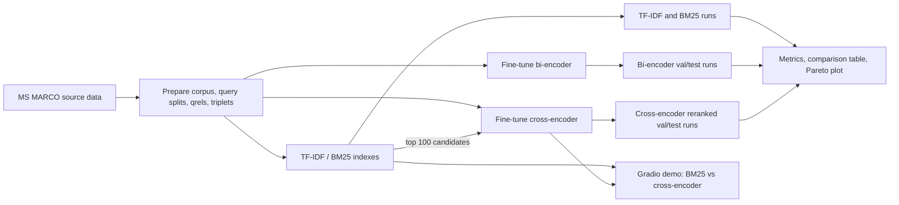

# Two-Stage Neural Passage Ranking

This project builds and evaluates an MS MARCO passage-retrieval pipeline that compares sparse lexical retrieval (TF-IDF and BM25), dense bi-encoder retrieval, and a two-stage BM25-plus-cross-encoder ranker. It includes data preparation, training and evaluation CLIs, latency/quality comparisons, retrieval ablations, and a Gradio demo. Neural training and full-corpus encoding are intended for a GPU runtime such as Google Colab; lexical baselines and unit tests can run on CPU.

## Architecture



## Setup

Run commands from this directory (`neural-ranking/`). Python 3.10–3.12 and a CUDA-enabled PyTorch runtime are recommended for training; CPU is sufficient for tests and lexical retrieval. Install the pinned dependencies:

```bash
python -m venv .venv
source .venv/bin/activate
python -m pip install --upgrade pip
python -m pip install -r requirements.txt
python -m pip install -e ".[dev]"
```

On Colab, clone the repository, enter `neural-ranking/`, enable a GPU runtime, and install the same dependencies:

```bash
!git clone https://github.com/Dhiraj7854/IR_PROJECT.git
%cd /content/IR_PROJECT/neural-ranking
%pip install -r requirements.txt
%pip install -e ".[dev]"
```

Prepare the MS MARCO data once. This downloads the configured source and writes the processed corpus, splits, qrels, and training triplets under `data/processed/`:

```bash
python scripts/prepare_data.py --config configs/config.yaml --output_dir data/processed
```

Generated data, model checkpoints, runs, and result files are ignored by Git. Keep them in Colab/Drive or copy them into the matching local directories before running downstream steps.

## Reproduce all results

All commands below are run from `neural-ranking/` after data preparation. Training, corpus embedding, cross-encoder reranking, the full comparison, and the model-backed demo require the corresponding checkpoints; use a Colab GPU for those stages.

### 1. Lexical baselines

Build/load the cached TF-IDF and BM25 indexes; generate validation and test TREC runs and log indexing/query latency:

```bash
python scripts/run_baseline.py --splits val test --methods tfidf bm25 --top-k 100
```

Run files are `artifacts/runs/{tfidf,bm25}_{val,test}.txt`.

### 2. Bi-encoder

Train the configured MiniLM bi-encoder with hard negatives, then encode the corpus once and produce val/test runs:

```bash
python scripts/train_biencoder.py --config configs/config.yaml --data-dir data/processed --output-dir artifacts/biencoder --negatives hard
python scripts/eval_biencoder.py --config configs/config.yaml --data-dir data/processed --artifacts-dir artifacts --model artifacts/biencoder --splits val test
```

Use `--negatives random` to reproduce the random-negative ablation checkpoint instead:

```bash
python scripts/train_biencoder.py --config configs/config.yaml --data-dir data/processed --output-dir artifacts/biencoder_random --negatives random
```

### 3. Cross-encoder

Train the explicit PyTorch cross-encoder and generate BM25 top-100 → reranked val/test runs:

```bash
python scripts/train_crossencoder.py --config configs/config.yaml --data-dir data/processed --output-dir artifacts/crossencoder
python scripts/eval_crossencoder.py --config configs/config.yaml --data-dir data/processed --artifacts-dir artifacts --model artifacts/crossencoder --candidate-depth 100 --splits val test
```

For the documented small overfit diagnostic, train on 100 queries for more epochs and inspect logged loss/validation MRR:

```bash
python scripts/train_crossencoder.py --data-dir data/processed --output-dir artifacts/crossencoder_overfit --max-train-queries 100 --epochs 10
```

### 4. Evaluate, compare, and plot

Compute per-query and macro metrics, median latency measured on 200 test queries, and the test-set Pareto plot:

```bash
python scripts/run_all_eval.py --config configs/config.yaml --data-dir data/processed --artifacts-dir artifacts --latency-queries 200
```

Outputs: `artifacts/results/comparison_table.md`, `comparison_table.csv`, `per_query_metrics.csv`, and `pareto.png`. The runner flags suspicious MRR values rather than treating them as accepted results. To inspect the table and plot interactively, open [`notebooks/02_results.ipynb`](notebooks/02_results.ipynb) from this directory after evaluation.

Evaluate an individual TREC run with the same project's metrics:

```bash
python scripts/evaluate.py --run_file artifacts/runs/bm25_test.txt --qrels_file data/processed/test_qrels.parquet --output_file artifacts/results/bm25_test_metrics.json
```

### 5. Ablations

Run the random-vs-hard negative, BM25 rerank-depth, and query-length experiments:

```bash
python scripts/run_experiments.py --config configs/config.yaml --data-dir data/processed --artifacts-dir artifacts
```

By default the random-negative model is retrained for two epochs. Use `--reuse-random-checkpoint` if `artifacts/biencoder_random/` already contains the trained checkpoint. The report and 150-dpi figures are written to `artifacts/results/ablations.md` and `ablations_*.png`.

### 6. Tests and command help

```bash
python -m pytest -q
python scripts/prepare_data.py --help
python scripts/run_baseline.py --help
python scripts/train_biencoder.py --help
python scripts/eval_biencoder.py --help
python scripts/train_crossencoder.py --help
python scripts/eval_crossencoder.py --help
python scripts/evaluate.py --help
python scripts/run_all_eval.py --help
python scripts/run_experiments.py --help
```

## Current comparison results

The lexical rows below are calculated from the existing test runs and `test_qrels.parquet`; TF-IDF and BM25 latency was measured over the first 200 test queries on this local CPU with the cached index. The full comparison outputs (`comparison_table.csv`, `comparison_table.md`, and `pareto.png`) are not present, and this checkout does not include neural checkpoints/runs. Neural results are therefore marked unavailable rather than estimated. Run the evaluation commands above after Colab training to generate the complete four-system comparison and plot.

| System | MRR@10 | NDCG@10 | P@5 | Recall@100 | Median latency (ms/query) |
|---|---:|---:|---:|---:|---:|
| TF-IDF | 0.2943 | 0.3854 | 0.1091 | 0.9073 | 35.95 |
| BM25 | 0.3316 | 0.4230 | 0.1192 | 0.9087 | 97.32 |
| Bi-encoder | Not generated | Not generated | Not generated | Not generated | Not generated |
| BM25 → Cross-encoder | Not generated | Not generated | Not generated | Not generated | Not generated |

Lexical metric outputs are in `artifacts/results/tfidf_test_metrics.json` and
`artifacts/results/bm25_test_metrics.json`; latency measurements and their
environment/sample are recorded in
[`artifacts/results/baseline_latency_local.json`](artifacts/results/baseline_latency_local.json).
Latencies are local CPU measurements; the complete comparison runner remeasures
all four systems on its execution hardware and writes the final table.

### Pareto plot

Generated as [`artifacts/results/pareto.png`](artifacts/results/pareto.png) by `scripts/run_all_eval.py`. It plots median end-to-end latency (logarithmic x-axis) against test MRR@10, with a labeled point for each system. The complete plot is not available yet because neural runs and checkpoints are absent; the two measured lexical points are insufficient for the requested all-system figure.

## Gradio demo

[`app/demo.py`](app/demo.py) is a Gradio Blocks application comparing BM25 top-10 with BM25 top-100 followed by cross-encoder reranking. It loads the corpus, lexical index, bi-encoder/cached embeddings, and cross-encoder once at startup; then displays rank, PID, score, a short passage excerpt, and per-column latency. Copy the trained checkpoints and bi-encoder embedding cache into `artifacts/`, install dependencies, and launch from this directory:

```bash
python app/demo.py
```

The current source includes four example queries from the test split. They have not been verified as the four largest top-3 disagreements because the necessary trained cross-encoder artifacts are not present in this checkout.

## Research report

[`report_skeleton.md`](report_skeleton.md) provides the paper/report structure and required literature citations. Populate its result tables from `artifacts/results/` after the model runs complete; analysis sections are intentionally left for the project author.
