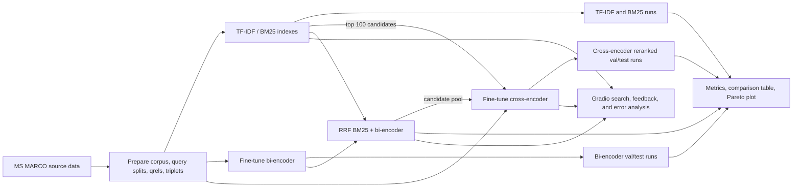

# Two-Stage Neural Passage Ranking

This project builds and evaluates an MS MARCO passage-retrieval pipeline that compares sparse lexical retrieval (TF-IDF and BM25), dense bi-encoder retrieval, and a two-stage BM25-plus-cross-encoder ranker. It includes data preparation, training and evaluation CLIs, latency/quality comparisons, retrieval ablations, and a Gradio demo. Neural training and full-corpus encoding are intended for a GPU runtime such as Google Colab; lexical baselines and unit tests can run on CPU.

## Architecture

The project now includes a rank-fusion layer for hybrid retrieval. `src/hybrid.py`
implements reciprocal rank fusion (RRF) for merging BM25 and dense bi-encoder
rankings without calibrating raw score magnitudes across retrievers.



## Setup

Run commands from this directory (`neural-ranking/`). Python 3.10–3.12 and a CUDA-enabled PyTorch runtime are recommended for training; CPU is sufficient for tests and lexical retrieval. Install the pinned dependencies:

```bash
python -m venv .venv
source .venv/bin/activate
python -m pip install --upgrade pip
python -m pip install -r requirements.txt
python -m pip install -e ".[dev]"
```

On Colab, clone the repository, enter `neural-ranking/`, enable a GPU runtime, and install the same dependencies:

```bash
!git clone https://github.com/Dhiraj7854/IR_PROJECT.git
%cd /content/IR_PROJECT/neural-ranking
%pip install -r requirements.txt
%pip install -e ".[dev]"
```

Prepare the MS MARCO data once. This downloads the configured source and writes the processed corpus, splits, qrels, and training triplets under `data/processed/`:

```bash
python scripts/prepare_data.py --config configs/config.yaml --output_dir data/processed
```

The sampler uses deterministic passage ordering, and the train/validation/test
query splits follow the source stream order. Re-running against the same
upstream dataset revision and configuration therefore regenerates the same
corpus IDs and qrels. Keep `data/processed/test_qrels.parquet` with experiment
artifacts; evaluation manifests also record its SHA-256 hash. This deterministic
ordering may not match passage IDs from older preparations, so use an existing
run/checkpoint bundle with its corresponding saved corpus and qrels.

Generated data, model checkpoints, runs, and result files are ignored by Git. Keep them in Colab/Drive or copy them into the matching local directories before running downstream steps.

### Restoring files from Google Drive

The saved `neural-ranking-output/` bundle contains model checkpoints, cached
embeddings, runs, and results, but it may not contain the prepared dataset.
Mount Drive and copy the bundle contents into `artifacts/` from the project
directory:

```python
from google.colab import drive
drive.mount("/content/drive")
```

```bash
%cd /content/IR_PROJECT/neural-ranking
!mkdir -p artifacts
!cp -a "/content/drive/MyDrive/IR_PROJECT/neural-ranking-output/." artifacts/
```

If `data/processed/` is missing, prepare it separately with the command above
or restore that folder from wherever it was saved. The output bundle is not a
replacement for the corpus, query splits, qrels, or training triplets.

## Reproduce all results

All commands below are run from `neural-ranking/` after data preparation. Training, corpus embedding, cross-encoder reranking, and the full comparison require a CUDA-enabled runtime for the intended workflow. The model-backed demo requires the corpus and all model checkpoints; a GPU is recommended for responsive inference.

### 1. Lexical baselines

Build/load the cached TF-IDF and BM25 indexes; generate validation and test TREC runs and log indexing/query latency:

```bash
python scripts/run_baseline.py --splits val test --methods tfidf bm25 --top-k 100
```

Run files are `artifacts/runs/{tfidf,bm25}_{val,test}.txt`.

### 2. Bi-encoder

Train the configured MiniLM bi-encoder with hard negatives, then encode the corpus once and produce val/test runs:

```bash
python scripts/train_biencoder.py --config configs/config.yaml --data-dir data/processed --output-dir artifacts/biencoder --negatives hard
python scripts/eval_biencoder.py --config configs/config.yaml --data-dir data/processed --artifacts-dir artifacts --model artifacts/biencoder --splits val test
```

Use `--negatives random` to reproduce the random-negative ablation checkpoint instead:

```bash
python scripts/train_biencoder.py --config configs/config.yaml --data-dir data/processed --output-dir artifacts/biencoder_random --negatives random
```

### 3. Cross-encoder

Train the explicit PyTorch cross-encoder and generate BM25 top-100 → reranked val/test runs:

```bash
python scripts/train_crossencoder.py --config configs/config.yaml --data-dir data/processed --output-dir artifacts/crossencoder_nli --epochs 3
python scripts/eval_crossencoder.py --config configs/config.yaml --data-dir data/processed --artifacts-dir artifacts --model artifacts/crossencoder_nli --candidate-depth 100 --top-k 100 --splits val test
```

The default initializer is `cross-encoder/nli-MiniLM2-L6-H768`. Its pretrained
sequence-classification head is preserved; three-way NLI logits are converted
to a relevance score using entailment minus contradiction. Query tokens are
preserved while only the passage may be truncated. Training writes to
`artifacts/crossencoder_nli/` by default so it does not replace the restored
legacy checkpoint in `artifacts/crossencoder/`.

The run contains the re-ranked top 100; the leading 10 entries per query are
the top-10 ranking. Keeping 100 entries is necessary for an actual
`Recall@100` calculation in the final comparison.

The default top-k is now 100. Candidate depth and reranking depth can be
configured independently. To generate candidate-depth comparisons for BM25
and RRF candidates (each run is saved under a depth-specific filename):

```bash
python scripts/eval_hybrid.py --candidate-depth 10 --rerank-depth 10 --top-k 100 --splits val test
python scripts/eval_hybrid.py --candidate-depth 50 --rerank-depth 50 --top-k 100 --splits val test
python scripts/eval_hybrid.py --candidate-depth 100 --rerank-depth 50 --top-k 100 --splits val test
```

This writes BM25→cross-encoder, RRF, and RRF→cross-encoder TREC runs and
per-run JSON metrics beneath `artifacts/runs/`. Candidate-generation recall is
reported separately from final ranking metrics. The reranker scores the
configured prefix and keeps the unreranked candidate tail in its original
order so the run can still contain 100 documents. Outputs are never replaced
unless `--overwrite` is explicitly passed.

For the documented small overfit diagnostic, train on 100 queries for more epochs and inspect logged loss/validation MRR:

```bash
python scripts/train_crossencoder.py --data-dir data/processed --output-dir artifacts/crossencoder_overfit --max-train-queries 100 --epochs 10
```

### 4. Evaluate, compare, and plot

Compute per-query and macro metrics, median latency measured on 200 test queries, and the test-set Pareto plot:

```bash
python scripts/run_all_eval.py --config configs/config.yaml --data-dir data/processed --artifacts-dir artifacts --latency-queries 200
```

The comparison runner includes depth-matched RRF and reranking runs when
present. It excludes `Recall@100` from truncated (<100 result) runs, records
the exact qrels file hash and run/config identifiers, and writes reproducible
paired bootstrap confidence intervals for metric differences versus both BM25
and TF-IDF to `artifacts/results/paired_differences.json`. The legacy BM25
comparison fields remain present for compatibility. Use
`--biencoder-model` and `--crossencoder-model` to select checkpoints other
than the default ones. It preserves existing comparison files unless
`--overwrite` is specified.

Outputs: `artifacts/results/comparison_table.md`, `comparison_table.csv`, `per_query_metrics.csv`, and `pareto.png`. The runner flags suspicious MRR values rather than treating them as accepted results. To inspect the table and plot interactively, open [`notebooks/02_results.ipynb`](notebooks/02_results.ipynb) from this directory after evaluation.

Evaluate an individual TREC run with the same project's metrics:

```bash
python scripts/evaluate.py --run_file artifacts/runs/bm25_test.txt --qrels_file data/processed/test_qrels.parquet --output_file artifacts/results/bm25_test_metrics.json
```

### 5. Ablations

Run the random-vs-hard negative, BM25 rerank-depth, and query-length experiments:

```bash
python scripts/run_experiments.py --config configs/config.yaml --data-dir data/processed --artifacts-dir artifacts
```

By default the random-negative model is retrained for two epochs. Use
`--reuse-random-checkpoint` if `artifacts/biencoder_random/` already contains
the trained checkpoint. `--biencoder-model` and `--crossencoder-model` allow
the ablations to run against separately trained checkpoints;
`--random-biencoder-model` selects the random-negative checkpoint. The report
and 150-dpi figures are written to `artifacts/results/ablations.md` and
`ablations_*.png`.

### 6. Hybrid RRF evaluation

`src/hybrid.py` fuses independent BM25 and bi-encoder rankings using
`sum(weight_i / (rrf_k + rank_i))`, with one-based ranks, default `rrf_k=60`,
and unit weights. It does not add uncalibrated raw retrieval scores. Ties are
resolved by canonical passage ID; source ranks and retriever names are retained.
`configs/config.yaml` supports `rrf_k`, optional `rrf_weights`, and independent
candidate/rerank depths.

```bash
python scripts/eval_hybrid.py --candidate-depth 100 --rerank-depth 50 --top-k 100 --splits val test
python scripts/run_all_eval.py --config configs/config.yaml --data-dir data/processed --artifacts-dir artifacts
```

For paired cross-encoder diagnosis, compare BM25 and RRF candidate runs from
the same query/qrels split and use the same candidate depth. Candidate recall
measures relevant passages present before reranking; final metrics measure the
ranked output. When reranking fewer than 100 candidates, the unscored tail is
preserved in candidate order so a full top-100 run is available. Run
`eval_hybrid.py` at candidate depths 10, 50, and 100 for a depth sweep.

### 7. Optional BEIR out-of-domain evaluation

BEIR is optional and no dataset is downloaded during install, tests, or search.
Explicitly prepare the official SciFact archive (or NFCorpus):

```bash
python -m pip install -e ".[beir]"
python scripts/prepare_beir.py --dataset scifact
python scripts/eval_beir.py --dataset scifact --candidate-depth 100 --rerank-depth 50 --top-k 100
```

To run NFCorpus, replace `scifact` with `nfcorpus`. Runs and metrics are stored
separately under `artifacts/beir/<dataset>/`. The evaluation uses the official
test qrels without tuning on them and labels its mode as zero-shot. A
cross-encoder run is included only when a compatible local project checkpoint
exists; otherwise BM25, bi-encoder, and RRF remain available. The corpus and
embedding cache are separate for each BEIR dataset.

### 8. Query enhancement

Unmodified query text is the default baseline. The optional methods are
Unicode/whitespace normalization, spelling correction, and dictionary-based
synonym expansion. Edit `configs/synonyms.json` to change expansion terms.
Spelling correction uses an optional package and preserves capitalization and
short tokens to reduce technical/proper-name changes.

```bash
python scripts/eval_query_enhancement.py --retriever bm25 --methods original normalize synonym --splits val test
python -m pip install -e ".[query-enhancement]"
python scripts/eval_query_enhancement.py --retriever bm25 --methods original spell --splits val test
```

The script saves transformed queries, ranked runs, per-query metrics, latency,
and paired metric changes versus the original query. It now constructs only
the selected sparse lexical index; BM25 uses sparse term-frequency postings
instead of retaining a large Python token list and BM25 object for every
passage. It also builds its output-path list without mutating the list being
iterated, which was the unbounded allocation behind the previous
query-enhancement `MemoryError`. A full 100,000-passage / 750-query validation
smoke test now completes locally; it is a code-path check, not a new reported
benchmark result. Enhancement is not enabled by default and its results are
separate from the baseline.

### Colab follow-up run for the outstanding claims

The saved results do not contain the requested retraining, negative-sampling,
query-length, query-enhancement, or BEIR SciFact results. The following
commands run those experiments without replacing the restored checkpoints or
saved comparison outputs. Start from the Colab setup above, enable a GPU, and
run these commands from `neural-ranking/`.

Train the hard-negative bi-encoder for a longer, early-stopped run and the
NLI-initialized cross-encoder into separate checkpoint directories:

```bash
python scripts/train_biencoder.py --config configs/config.yaml --data-dir data/processed --output-dir artifacts/biencoder_extended --negatives hard --epochs 5 --patience 3 --seed 42
python scripts/train_biencoder.py --config configs/config.yaml --data-dir data/processed --output-dir artifacts/biencoder_random --negatives random --epochs 5 --patience 3 --seed 42
python scripts/train_crossencoder.py --config configs/config.yaml --data-dir data/processed --model-name cross-encoder/nli-MiniLM2-L6-H768 --output-dir artifacts/crossencoder_nli --epochs 3 --batch-size 32 --max-length 256 --seed 42
```

Create an isolated output bundle and copy the new checkpoints into it. The
original `artifacts/biencoder/` and `artifacts/crossencoder/` remain untouched:

```bash
mkdir -p artifacts/retrained
cp -a artifacts/biencoder_extended artifacts/retrained/
cp -a artifacts/crossencoder_nli artifacts/retrained/
cp -a artifacts/biencoder_random artifacts/retrained/
python scripts/run_baseline.py --artifacts_dir artifacts/retrained --data_dir data/processed --splits val test --methods tfidf bm25 --top_k 100
python scripts/eval_biencoder.py --config configs/config.yaml --data-dir data/processed --artifacts-dir artifacts/retrained --model artifacts/retrained/biencoder_extended --splits val test
python scripts/eval_crossencoder.py --config configs/config.yaml --data-dir data/processed --artifacts-dir artifacts/retrained --model artifacts/retrained/crossencoder_nli --candidate-depth 100 --top-k 100 --splits val test
python scripts/eval_hybrid.py --config configs/config.yaml --data-dir data/processed --artifacts-dir artifacts/retrained --biencoder-model artifacts/retrained/biencoder_extended --crossencoder-model artifacts/retrained/crossencoder_nli --candidate-depth 100 --rerank-depth 50 --top-k 100 --splits val test --overwrite
python scripts/run_experiments.py --config configs/config.yaml --data-dir data/processed --artifacts-dir artifacts/retrained --biencoder-model biencoder_extended --crossencoder-model crossencoder_nli --reuse-random-checkpoint
python scripts/run_all_eval.py --config configs/config.yaml --data-dir data/processed --artifacts-dir artifacts/retrained --biencoder-model biencoder_extended --crossencoder-model crossencoder_nli --latency-queries 200 --overwrite
```

Evaluate query normalization and synonym expansion on both lexical systems.
Spelling correction is optional and requires the `query-enhancement` extra:

```bash
python scripts/eval_query_enhancement.py --config configs/config.yaml --data-dir data/processed --artifacts-dir artifacts/retrained --retriever bm25 --methods original normalize synonym --splits val test
python scripts/eval_query_enhancement.py --config configs/config.yaml --data-dir data/processed --artifacts-dir artifacts/retrained --retriever tfidf --methods original normalize synonym --splits val test
```

Run the zero-shot SciFact evaluation. This downloads the dataset only when the
explicit preparation command is invoked:

```bash
python -m pip install -e ".[beir]"
python scripts/prepare_beir.py --dataset scifact
python scripts/eval_beir.py --dataset scifact --data-dir data/beir --artifacts-dir artifacts/retrained --biencoder-model artifacts/retrained/biencoder_extended --crossencoder-model artifacts/retrained/crossencoder_nli --candidate-depth 100 --rerank-depth 50 --top-k 100 --overwrite
```

Review `artifacts/retrained/results/` and `artifacts/retrained/beir/scifact/`
before updating report claims. Save the generated bundle to Drive or download
it from Colab so the per-query runs, manifests, and checkpoints can be
reviewed together:

```python
from google.colab import drive
drive.mount("/content/drive")
```

```bash
cp -a artifacts/retrained "/content/drive/MyDrive/IR_PROJECT/"
```

Do not report a new score until the corresponding run, qrels fingerprint, and
evaluation manifest are present. A successful execution only demonstrates
that the experiment ran; it does not establish that the new system improved.

### 9. Performance benchmark

The benchmark warms each selected method, uses the same selected query set
and result depth, and reports mean warm-query latency, p50, p95, throughput,
Python-tracked peak memory, and retrieval quality:

```bash
python scripts/benchmark_retrieval.py --split test --methods tfidf bm25 --query-limit 200 --top-k 100
python scripts/benchmark_retrieval.py --split test --methods bm25 biencoder rrf --query-limit 200 --top-k 100
```

Memory uses `tracemalloc` and does not include all native/GPU allocations.
For cross-method comparisons, run on the same hardware, query set, warm-up,
and result depth.

### 10. Tests and command help

```bash
python -m pytest -q
python scripts/prepare_data.py --help
python scripts/run_baseline.py --help
python scripts/train_biencoder.py --help
python scripts/eval_biencoder.py --help
python scripts/train_crossencoder.py --help
python scripts/eval_crossencoder.py --help
python scripts/evaluate.py --help
python scripts/run_all_eval.py --help
python scripts/run_experiments.py --help
python scripts/eval_hybrid.py --help
python scripts/eval_query_enhancement.py --help
python scripts/prepare_beir.py --help
python scripts/eval_beir.py --help
python scripts/benchmark_retrieval.py --help
```

The tests use small synthetic corpora and do not download datasets or model
checkpoints. Dataset integration tests require the prepared MS MARCO files.

## Metrics and evaluation conventions

- **MRR@10:** reciprocal rank of the first positively judged result, averaged
  over qrels query IDs.
- **NDCG@10:** graded gain `2^relevance - 1`, discounted by `log2(rank+1)`,
  normalized by the ideal ordering.
- **Recall@10 / Recall@100:** fraction of positively judged passages retrieved
  within the cutoff. Queries with no positive judgments score zero.
- **MAP@10:** precision at each positive hit in the top 10, divided by the
  total number of positive qrels for that query.
- **P@5:** positive hits in the first five divided by five.

Missing relevance values are skipped as unjudged qrels rows; qrels with no
positive labels yield zero-valued metrics. Empty runs and missing query results
are scored as zero. The standalone `evaluate.py` refuses to report
Recall@100 from runs shorter than 100 documents. The comparison runner also
omits it for truncated run files and marks its validity. Candidate recall is
reported separately. `run_all_eval.py` writes paired, query-level bootstrap
intervals for differences from BM25 and TF-IDF; intervals are descriptive and
do not replace repeated-seed experiments.

## Current comparison results

Saved MS MARCO outputs have been restored under `data/processed/` and
`artifacts/`. The comparison below is from the **750-query test split**; latency
is the median over 200 test queries on the original Colab runtime. All listed
runs contain a valid depth-100 result set. The qrels and query hashes in
`artifacts/results/evaluation_manifest.json` match the restored files. Its
manifest preserves the configuration used for the original run; it differs
from the current configuration because the cross-encoder initializer has
since changed. Retain the manifest as the authoritative record of the saved
run.

| System | MRR@10 | NDCG@10 | Recall@10 | Recall@100 | MAP@10 | Median latency (ms/query) |
|---|---:|---:|---:|---:|---:|---:|
| TF-IDF | 0.2943 | 0.3854 | 0.6910 | 0.9073 | 0.2874 | 45.96 |
| BM25 | 0.3316 | 0.4230 | 0.7269 | 0.9087 | 0.3247 | 151.89 |
| Bi-encoder | 0.4892 | 0.5788 | 0.8720 | 0.9820 | 0.4831 | 8.24 |
| BM25 → Cross-encoder (legacy) | 0.3970 | 0.4772 | 0.7444 | 0.9087 | 0.3902 | 272.23 |
| Hybrid RRF | 0.4822 | 0.5687 | 0.8531 | 0.9947 | 0.4746 | 149.74 |
| Hybrid RRF → Cross-encoder (legacy) | 0.3402 | 0.4237 | 0.7086 | 0.9947 | 0.3319 | 209.05 |
| BM25 → Cross-encoder (fixed candidates, depth 100 / rerank 50; legacy) | 0.4312 | 0.5072 | 0.7620 | 0.9087 | 0.4231 | 199.94 |

These are actual saved test outputs, not newly rerun results. The cross-encoder
rows use the legacy MS MARCO-initialized checkpoint, whose pretrained
classification head was discarded by the previous trainer. Because its
backbone was pretrained on MS MARCO, treat its test scores as exploratory,
not as an uncontaminated held-out comparison. The current trainer instead
defaults to an NLI-initialized sequence classifier and writes a new checkpoint
to `artifacts/crossencoder_nli/`; its results remain pending. The run-level
metrics, per-query scores, and ranked lists are in `artifacts/runs/`; summary
tables, paired differences, and the plot are in `artifacts/results/`.
`paired_differences.json` reports paired bootstrap intervals against both
BM25 and TF-IDF over 750 queries (2,000 resamples). The bi-encoder's MRR@10
difference is +0.1575 vs. BM25 (95% CI +0.1267 to +0.1912) and +0.1949 vs.
TF-IDF (95% CI +0.1633 to +0.2265). These intervals describe this test set
and are not repeated-seed uncertainty estimates.

The test result indicates that hybrid RRF substantially improves over BM25,
but does not outperform the bi-encoder on MRR@10 or NDCG@10; it does achieve
the highest Recall@100 of the listed systems. Cross-encoder reranking is not
uniformly beneficial: the fixed BM25 candidate experiment improves MRR@10
relative to BM25, while the RRF-generated candidate reranking result falls
below the unreranked RRF result. The fixed-candidate depth sweep and its
candidate recall are reported in the per-run metrics; candidate recall is not
the same as final ranking quality.

The original query-enhancement evaluation did **not** finish in Colab. A
reproduction found an unbounded output-path list construction that raised
`MemoryError`; the code now creates a finite path list and builds only the
requested compact sparse lexical index. The local full-corpus validation smoke
test completed, but no new query-enhancement benchmark result is reported.
BEIR SciFact, longer-training, repeated-seed, query-length, and
negative-sampling results are also pending; the README provides a Colab run
that writes them to a separate output bundle.

## Gradio demo

[`app/demo.py`](app/demo.py) is a Gradio Blocks search and evaluation dashboard.
It loads the corpus, cached lexical indexes, bi-encoder and embeddings, and
cross-encoder once at startup. On the Search tab, compare one or more of
TF-IDF, BM25, bi-encoder, BM25 → cross-encoder, Hybrid RRF, and Hybrid RRF →
cross-encoder. Result cards show rank,
PID, score, a passage excerpt, query-term highlights, and rank movement
relative to BM25. Settings control the systems, number of results, and
candidate depth. Summary tiles, overlap
donut, and latency bars help explain how the rankings differ.

The Query error analysis tab is enabled when test queries and qrels are
prepared. It distinguishes judged test queries from live queries, displays
relevant/missed IDs and per-query metrics, and compares candidate recall and
rank movement. Filters include query length and (when generated per-query
metrics are available) retrieval failures, low-quality queries, and hybrid
improvements/damages. The Relevance feedback tab offers session-local explicit
positive/negative labels and a TF-IDF Rocchio update; its results are not
treated as benchmark judgments.

The Benchmarks tab renders the evaluation table and responsive inline SVG
charts for quality versus latency and the three ablation studies. The SVG
charts scale with the page, show exact point values on hover, and replace the
previous static PNG display. The ablation charts are shown when
`artifacts/results/ablations.md` is present; comparison metrics are read from
`artifacts/results/comparison_table.csv`; no fallback benchmark values are
shown when outputs are absent.
The How it works tab explains the rankers and metrics.

After restoring the checkpoints, embedding cache, and prepared corpus, launch
from this directory:

```bash
python app/demo.py
```

In Colab, the app detects the runtime and creates a `gradio.live` share URL
automatically. Open that URL from the cell output; `127.0.0.1:7860` refers to
the Colab VM and is not reachable from your local browser. To explicitly
request a share URL outside Colab, run:

```bash
python app/demo.py --share
```

Share URLs are publicly accessible while active; do not use them for private
data. To choose a different local port, pass `--port`, for example
`python app/demo.py --port 7861`.

The example queries were selected from the test run by maximizing disagreement
between BM25 and cross-encoder top-3 results (zero overlapping PIDs; multiple
queries tie at this maximum).

## Research report

[`report_skeleton.md`](report_skeleton.md) contains the completed narrative for
the saved results, paired TF-IDF analysis, references, limitations, and a clear
separation between measured results and pending Colab experiments.
