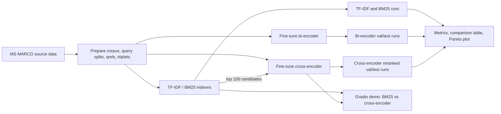

# Two-Stage Neural Passage Ranking

This project builds and evaluates an MS MARCO passage-retrieval pipeline that compares sparse lexical retrieval (TF-IDF and BM25), dense bi-encoder retrieval, and a two-stage BM25-plus-cross-encoder ranker. It includes data preparation, training and evaluation CLIs, latency/quality comparisons, retrieval ablations, and a Gradio demo. Neural training and full-corpus encoding are intended for a GPU runtime such as Google Colab; lexical baselines and unit tests can run on CPU.

## Architecture



## Setup

Run commands from this directory (`neural-ranking/`). Python 3.10–3.12 and a CUDA-enabled PyTorch runtime are recommended for training; CPU is sufficient for tests and lexical retrieval. Install the pinned dependencies:

```bash
python -m venv .venv
source .venv/bin/activate
python -m pip install --upgrade pip
python -m pip install -r requirements.txt
python -m pip install -e ".[dev]"
```

On Colab, clone the repository, enter `neural-ranking/`, enable a GPU runtime, and install the same dependencies:

```bash
!git clone https://github.com/Dhiraj7854/IR_PROJECT.git
%cd /content/IR_PROJECT/neural-ranking
%pip install -r requirements.txt
%pip install -e ".[dev]"
```

Prepare the MS MARCO data once. This downloads the configured source and writes the processed corpus, splits, qrels, and training triplets under `data/processed/`:

```bash
python scripts/prepare_data.py --config configs/config.yaml --output_dir data/processed
```

Generated data, model checkpoints, runs, and result files are ignored by Git. Keep them in Colab/Drive or copy them into the matching local directories before running downstream steps.

## Reproduce all results

All commands below are run from `neural-ranking/` after data preparation. Training, corpus embedding, cross-encoder reranking, the full comparison, and the model-backed demo require the corresponding checkpoints; use a Colab GPU for those stages.

### 1. Lexical baselines

Build/load the cached TF-IDF and BM25 indexes; generate validation and test TREC runs and log indexing/query latency:

```bash
python scripts/run_baseline.py --splits val test --methods tfidf bm25 --top-k 100
```

Run files are `artifacts/runs/{tfidf,bm25}_{val,test}.txt`.

### 2. Bi-encoder

Train the configured MiniLM bi-encoder with hard negatives, then encode the corpus once and produce val/test runs:

```bash
python scripts/train_biencoder.py --config configs/config.yaml --data-dir data/processed --output-dir artifacts/biencoder --negatives hard
python scripts/eval_biencoder.py --config configs/config.yaml --data-dir data/processed --artifacts-dir artifacts --model artifacts/biencoder --splits val test
```

Use `--negatives random` to reproduce the random-negative ablation checkpoint instead:

```bash
python scripts/train_biencoder.py --config configs/config.yaml --data-dir data/processed --output-dir artifacts/biencoder_random --negatives random
```

### 3. Cross-encoder

Train the explicit PyTorch cross-encoder and generate BM25 top-100 → reranked val/test runs:

```bash
python scripts/train_crossencoder.py --config configs/config.yaml --data-dir data/processed --output-dir artifacts/crossencoder
python scripts/eval_crossencoder.py --config configs/config.yaml --data-dir data/processed --artifacts-dir artifacts --model artifacts/crossencoder --candidate-depth 100 --top-k 100 --splits val test
```

The run contains the re-ranked top 100; the leading 10 entries per query are
the top-10 ranking. Keeping 100 entries is necessary for an actual
`Recall@100` calculation in the final comparison.

For the documented small overfit diagnostic, train on 100 queries for more epochs and inspect logged loss/validation MRR:

```bash
python scripts/train_crossencoder.py --data-dir data/processed --output-dir artifacts/crossencoder_overfit --max-train-queries 100 --epochs 10
```

### 4. Evaluate, compare, and plot

Compute per-query and macro metrics, median latency measured on 200 test queries, and the test-set Pareto plot:

```bash
python scripts/run_all_eval.py --config configs/config.yaml --data-dir data/processed --artifacts-dir artifacts --latency-queries 200
```

Outputs: `artifacts/results/comparison_table.md`, `comparison_table.csv`, `per_query_metrics.csv`, and `pareto.png`. The runner flags suspicious MRR values rather than treating them as accepted results. To inspect the table and plot interactively, open [`notebooks/02_results.ipynb`](notebooks/02_results.ipynb) from this directory after evaluation.

Evaluate an individual TREC run with the same project's metrics:

```bash
python scripts/evaluate.py --run_file artifacts/runs/bm25_test.txt --qrels_file data/processed/test_qrels.parquet --output_file artifacts/results/bm25_test_metrics.json
```

### 5. Ablations

Run the random-vs-hard negative, BM25 rerank-depth, and query-length experiments:

```bash
python scripts/run_experiments.py --config configs/config.yaml --data-dir data/processed --artifacts-dir artifacts
```

By default the random-negative model is retrained for two epochs. Use `--reuse-random-checkpoint` if `artifacts/biencoder_random/` already contains the trained checkpoint. The report and 150-dpi figures are written to `artifacts/results/ablations.md` and `ablations_*.png`.

### 6. Tests and command help

```bash
python -m pytest -q
python scripts/prepare_data.py --help
python scripts/run_baseline.py --help
python scripts/train_biencoder.py --help
python scripts/eval_biencoder.py --help
python scripts/train_crossencoder.py --help
python scripts/eval_crossencoder.py --help
python scripts/evaluate.py --help
python scripts/run_all_eval.py --help
python scripts/run_experiments.py --help
```

## Current comparison results

The values below come from the completed Colab evaluation against the 750-query test split. Latency is the median over 200 queries in that Colab run. Exact outputs are in [`artifacts/results/comparison_table.csv`](artifacts/results/comparison_table.csv), [`comparison_table.md`](artifacts/results/comparison_table.md), and [`per_query_metrics.csv`](artifacts/results/per_query_metrics.csv).

| System | MRR@10 | NDCG@10 | P@5 | Recall@100 | Median latency (ms/query) |
|---|---:|---:|---:|---:|---:|
| TF-IDF | 0.2943 | 0.3854 | 0.1091 | 0.9073 | 55.13 |
| BM25 | 0.3316 | 0.4230 | 0.1192 | 0.9087 | 153.47 |
| Bi-encoder | 0.4895 | 0.5790 | 0.1525 | 0.9820 | 7.42 |
| BM25 → Cross-encoder | 0.4016 | 0.4835 | 0.1272 | 0.7544* | 284.89 |

All runs contain 750 test queries; latency was measured over 200 test queries
in Colab. `*` The cross-encoder run file contains only ranks 1–10 (7,500 lines
for 750 queries), so its reported `Recall@100` is recall over the returned
top-10, not true Recall@100. Re-run cross-encoder evaluation with `--top-k 100`
before comparing that metric at depth 100. The comparison runner did not flag
any configured suspicious scores.

The extracted output bundle did not include Colab's `test_qrels.parquet`.
Consequently, the Colab metrics are recorded as reported by its generated
comparison files, but cannot currently be independently reproduced against the
local qrels file. For a local end-to-end verification, also copy the exact
`test_qrels.parquet` used in Colab into `data/processed/`.

Training metadata records one completed epoch (55 optimizer steps) for each
bi-encoder run; best sampled-validation MRR@10 was 0.9705 for hard negatives
and 0.9712 for random negatives. The cross-encoder completed 658 steps in
273.59 seconds and saved its best checkpoint at validation MRR@10 0.4134
(step 329). Bi-encoder validation uses a sampled 2,000-passage corpus; these
training-time validation scores are not directly comparable to the full-corpus
test scores above.

### Pareto plot


Generated by `scripts/run_all_eval.py`; latency is on a logarithmic x-axis.

### Ablation results

Full tables and figures are in [`artifacts/results/ablations.md`](artifacts/results/ablations.md).

| Experiment | Setting | MRR@10 | Median latency (ms/query) |
|---|---|---:|---:|
| Bi-encoder negative sampling (validation) | Hard | 0.4968 | — |
| Bi-encoder negative sampling (validation) | Random | 0.5260 | — |
| Cross-encoder depth (validation) | BM25 top-50 | 0.4451 | 203.83 |
| Cross-encoder depth (validation) | BM25 top-100 | 0.4134 | 265.49 |
| Cross-encoder depth (validation) | BM25 top-200 | 0.3764 | 344.82 |

Query-length analysis (test split):

| Bucket | Queries | Word count | BM25 MRR@10 | BM25 → Cross-encoder MRR@10 |
|---|---:|---:|---:|---:|
| Short | 250 | 2–5 | 0.3664 | 0.4322 |
| Medium | 250 | 5–7 | 0.3029 | 0.3808 |
| Long | 250 | 7–22 | 0.3256 | 0.3919 |


## Gradio demo

[`app/demo.py`](app/demo.py) is a Gradio Blocks application comparing BM25 top-10 with BM25 top-100 followed by cross-encoder reranking. It loads the corpus, lexical index, bi-encoder/cached embeddings, and cross-encoder once at startup; then displays rank, PID, score, a short passage excerpt, and per-column latency. Copy the trained checkpoints and bi-encoder embedding cache into `artifacts/`, install dependencies, and launch from this directory:

```bash
python app/demo.py
```

The example queries were selected from the test run by maximizing disagreement
between BM25 and cross-encoder top-3 results (zero overlapping PIDs; multiple
queries tie at this maximum).

## Research report

[`report_skeleton.md`](report_skeleton.md) provides the paper/report structure and required literature citations. Populate its result tables from `artifacts/results/` after the model runs complete; analysis sections are intentionally left for the project author.